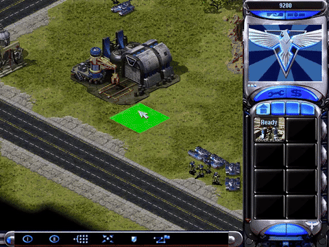

# Red Alert 2 on Linux

This project runs base Command & Conquer: Red Alert 2 1.006 as a native Linux program. It converts your copy of `game.exe` to C and uses pcrecomp for Windows calls. You need your own copy of Red Alert 2. This project is independent of Electronic Arts.



[Skirmish](docs/media/skirmish.mp4) · [Campaign start and radar movie](docs/media/campaign.mp4) · [Menus](docs/media/menus.mp4)

## Status

| Area | Verification |
| --- | --- |
| Skirmish | 71 of 71 maps matched in the tests. 53 reached frame 20,000, 17 ended naturally, and one reproduced the original crash. [Report](docs/verification/skirmish.md) |
| Campaign | 26 of 26 scenarios matched with recorded orders, including two Boot Camp missions. [Report](docs/verification/campaign.md) |
| Menus, saves, and endings | Menus, skirmish cross-load in both directions, campaign save and load, and win and loss checks passed. [Report](docs/verification/ui-save.md) |
| Display | Five fixes passed checks for the map preview, slider, drop-down, score title, and control positions. [Report](docs/verification/screens.md) |
| CPU cost | 62% fewer CPU cycles per frame than the earlier native build in the tested OpenGL setup. [Report](docs/verification/performance.md) |
| Movies | All 83 archive movies finished two cycles. Two damaged clips briefly repeat the last good picture. [Report](docs/verification/movies.md) |

The [release candidate report](docs/verification/release.md) lists the final checks.

## Limits

- Online play and Yuri's Revenge are outside this release.
- Save files differ at the byte level. The tested skirmish saves load in both directions.
- The native build still uses about 2.9× the original's CPU cycles per frame under Wine in the recorded comparison.
- Campaign tests cover the recorded orders and outcomes. Five runs stop at frame 20,000.

## Requirements

- An x86 Linux system that runs 32-bit programs.
- Your installed base Red Alert 2 files, including `Blowfish.dll`. The installer accepts the tested 1.006 executable with SHA-256 `73288c03b58d370be268ca6d156b4e33bfdb2066dc980359467d8852ff3b00df`.
- GCC with 32-bit support, CMake, Ninja, pkg-config, Python 3, and Liberation Sans fonts.
- 32-bit SDL2, SDL2_ttf, and FFmpeg development libraries. The installer names the missing tools and packages for Arch, Debian, Ubuntu, and Fedora.
- Space for a local copy of the game files and a temporary build. The first build takes tens of minutes. Python can use installed Capstone and pefile modules or download them into a temporary environment.

## Install

```sh
git clone https://github.com/HaseebUllahButt/ra2-linux.git
cd ra2-linux
./install.sh
```

Enter the path to your Red Alert 2 folder when prompted. The installer checks the executable, copies the game files, converts the code, and builds the Linux program. It installs under `~/.local/share/ra2-linux` and adds a desktop entry.

Use `./install.sh --game-dir "/path/to/Red Alert 2" --jobs 4` to provide the path and limit the number of build jobs.

Run `./install.sh --uninstall` to remove the game program, copied files, and launchers. Add `--purge` to also remove local saves and settings.

## Play

Open **Red Alert 2 (Native Linux)** from your desktop menu or run either command.

```sh
~/.local/bin/ra2-linux
./play.sh --scale integer
```

Integer scale shows a centered 800×600 picture in a 1024×768 window and uses whole-number multiples in larger windows. The installed game keeps settings and saves in `~/.local/share/ra2-linux/game/`. The first launch skips the long intro. Set `Play=yes` under `[Intro]` in your installed `RA2.INI` to watch it.

## Credits and license

This project builds on [sp00nznet/redalert2-recomp](https://github.com/sp00nznet/redalert2-recomp) and [sp00nznet/pcrecomp](https://github.com/sp00nznet/pcrecomp). The source snapshots are from `4ecdea4` and `91998d6`. See the [game contributors](CONTRIBUTORS.md) and the [runtime contributors](pcrecomp/CONTRIBUTORS.md) for upstream credit.

Both projects use the MIT license. See the [game license](LICENSE), [runtime license](pcrecomp/LICENSE), [game notice](NOTICE.md), and [runtime notice](pcrecomp/NOTICE).

Command & Conquer and Red Alert 2 belong to their respective rights holders. This project is unaffiliated with EA. The repository supplies source and gameplay recordings. Bring your own game executable and data.
