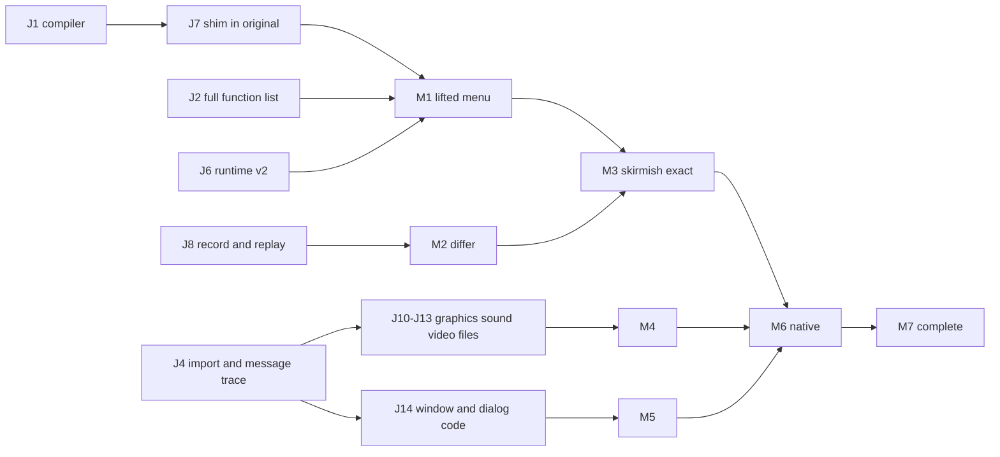

# RA2 static recompilation: execution plan

Written 2026-11-11 23:30 PKT. Clock starts 2026-11-12 00:00 PKT. All dates are PKT.

## 1. The three ideas that cut the most time

1. **Two tracks that do not wait for each other.**
   - Lifter track: lifted code runs inside the ORIGINAL game process under Wine. Functions switch on in groups.
   - Adapter track: our DirectDraw, DirectSound, Bink, Blowfish and Windows-call code is tested against the ORIGINAL game.exe under Wine, as drop-in DLLs. It needs no lifted code.
   - The tracks join only at the end. Total time is the longer track, not the sum.
2. **One program, two builds.** The adapter uses only SDL2 and the C library. Build it as a Windows DLL (SDL2 for Windows, under Wine) and as a Linux library. When every Windows group runs on the adapter under Wine, the Linux build is a compile step.
3. **Machines find the bugs.** Record a game on the original. Replay it on the changed build at high speed. Stop at the first memory byte that differs. A bot narrows it to one function. An agent fixes the lifter rule. No person looks at the screen.

## 2. Facts that the plan must respect (measured 2026-11-11)

- The 12,423-function list covers 82% of the code. About 530 KB (1,600+ functions, reached only through pointers) is not lifted. Tests hid this: unlisted code runs as original machine code.
- The runtime has one global register state and one saved stack pointer. Callbacks, nested calls and threads break it. Call sites: 3 CreateThread, 1 timeSetEvent, 20 SetTimer.
- 307 of 368 imports have call sites. Menus are real Windows dialogs: 227 SendMessageA and 62 SendDlgItemMessageA call sites; list view, slider, combo box, hotkey, progress controls.
- No 32-bit Windows compiler is installed on test-host. Wine 11 is the 32-on-64 type.
- The repo has no commit yet.

## 3. Milestones

"Target" needs the speed-ups in this plan to work. "Worst" is the date to tell a client.

| # | Milestone | Done-check | Target | Worst |
|---|---|---|---|---|
| M0 | Base ready | Compiler works; function list covers 99% of code; instruction fuzzer runs; shim loads in original game; import trace exists | Nov 12 | Nov 14 |
| M1 | Lifted game shows main menu under Wine | All functions switched on; menu draws; mouse works | Nov 14 | Nov 21 |
| M2 | Lockstep differ works | Original against original: zero differing bytes on a 5-minute game, after the noise mask | Nov 15 | Nov 19 |
| M3 | One full skirmish exact | Lifted against original: zero differing bytes, every frame, start to win | Nov 19 | Dec 3 |
| M3b | Exact at scale | 20 recorded skirmishes exact; zero fallbacks to original code | Nov 24 | Dec 10 |
| M4 | Original game on our graphics, sound, video, MIX key code (under Wine) | Skirmish plays with our four DLLs; call logs show no missing method | Nov 22 | Dec 1 |
| M5 | Original game on our window and dialog code (under Wine) | Menu to skirmish to quit; message logs equal on 3 recordings | Dec 1 | Dec 22 |
| M6 | Native Linux: menu and skirmish with sound | Linux program, no Wine; one replay exact against the original | Dec 5 | Jan 5 |
| M7 | Native Linux complete | Movies, save and load, options, campaign start; 20 replays exact | Dec 15 | Jan 31 |

## 4. Critical path

- **The longest chain is J4 -> J14 (window and dialog code) -> M5 -> M6.** Put the strongest crew on J14 from hour 0.
- The lifter chain (J1 -> J7 -> M1 -> M3) is shorter. Its risk is hidden lifter bugs; J5 and J15 remove that risk.
- Everything else has slack.

## 5. Verdict on each speed-up idea

| Idea | Verdict | How |
|---|---|---|
| Generate the Windows layer from Wine or ReactOS source | Partly | Good for pure logic: dialog templates, list box, combo, edit state, text format, OLE storage. Bad for the window core (Wine splits it over three parts). Give agents the Wine source as reference and the Wine program as the judge. Wine is LGPL: fine in private; check before any release. |
| Trace the Windows functions a skirmish uses; stub the rest | Yes, hour 1 | `WINEDEBUG=+relay` on the original. A stub stops with the function name. Never a silent stub. |
| Record and replay Windows calls as test oracle | Yes, core | Shim records time, input and messages. Replay feeds the same values. Time is virtual, so a 30-minute game replays in about 2 minutes. |
| Whole-game lockstep differ | Yes, core | Shim gives both runs the same memory allocator at a fixed address. Then all pointers are equal and a byte compare works. First run original against original to find noise bytes. |
| Find pointer-only code by logging executed addresses | Yes, three ways | (1) Static scan: 5,266 pointers into unlisted code found already. (2) One-shot breakpoint byte at each unlisted code start in the original; no slowdown. (3) Runtime logs each fallback. |
| Agents fix lifter bugs from differ output | Yes | Only rule changes in `lift.py`. Gate: instruction fuzzer and all stored replays pass. No hand edits of lifted files. |

Added ideas:

- **Instruction fuzzer (J5).** For each different instruction form in game.exe, run the real bytes and the lifted C on 2,000 random states. Compare registers, flags, memory, x87. This proves the lifter per instruction in minutes, before any whole-game run.
- **Entry patch as the single switch.** In the Wine process, write a jump at the start of each original function to its lifted version. This handles callbacks from Windows, group on/off, and fallback, with one mechanism.
- **Drop-in DLL tests.** ddraw.dll, dsound.dll, binkw32.dll and Blowfish.dll are separate files. Our versions replace them under the original game today. The game folder already uses a ddraw.dll override.
- **Golden-file farm (J9).** For each pure Windows function, a small Wine program writes inputs and results to a file. Free workers write portable C until all rows match. No review cost.
- **Existing code as base.** cnc-ddraw is a DirectDraw replacement made for these games. isle-portable has a small Windows-on-SDL layer. Use both as reference. Check each licence first.
- **Execution census.** One-shot breakpoints at all function starts show which functions a skirmish really runs. Verify those first.
- **Replay farm (J15).** Every idle core replays recordings against the newest build, day and night.
- **Fallback stays.** Unlisted code runs as original bytes and is logged. The count must be zero at M3b.

## 6. Jobs that can start now, in parallel

Models: Fable or Opus for design and hard runtime work. Codex sol for lifter and adapter modules. Codex terra for bounded fixes. Sonnet for set-up and glue. GLM, DeepSeek and MiniMax only for jobs with a script that decides pass or fail.

| Job | Owner model | Machine | Exact input | Exact done-check |
|---|---|---|---|---|
| J1 Compiler | Sonnet | why, then test-host | No root. Try `zig cc -target x86-windows-gnu`, else nix mingw32 | `hello.exe` and `hello.dll` build and print OK under `wine` with `original/prefix` |
| J2 Full function list | Codex terra | why | `tools/lift.py`, game.exe, `ra2-1to1/inputs/all-addresses.txt`, `ra2-1to1/inputs/gap/applied-vtables.json` | New `tools/coverage.py` prints: 99% or more of non-padding code bytes lifted; each remaining gap has a class (jump table, data, dead); `tests/entries-v2.txt` written |
| J3 Execution census | Opus | test-host (census kit, original) | J7 shim; `entries-v2.txt`; gap starts | `reports/executed.txt` and `reports/unlisted-hit.txt` exist after menu plus one skirmish; every unlisted hit is added to the list |
| J4 Import and message trace | Sonnet | test-host | Original game; `WINEDEBUG=+relay` limited to game.exe | `reports/imports-used.txt` (name, count), `reports/messages-used.txt` (window class, message), `reports/threads.txt` (start address and purpose of each thread and timer callback) |
| J5 Instruction fuzzer | Codex sol | why | `lift.py` emitter; all instruction forms in game.exe | `tools/insnfuzz.sh` prints 0 mismatches for all forms, with x87 at 53-bit and 64-bit precision |
| J6 Runtime v2 | Fable | why | `rt/rc.h`, `rt/rc_rt.c`, `rt/bridge.S` | Test passes: Windows calls lifted code 3 levels deep while a second thread runs lifted code; all 77 existing test rows still exact |
| J7 Shim in original process | Opus | why | J1; `ra2-1to1` files `pilot_rt.c`, `hybrid.c` | Launcher starts original game.exe with `rc.dll`; zero functions on: menu shows; C library leaf group on: menu shows |
| J8 Record, replay, fixed allocator | Fable | test-host | J7 shim | Original against original on a 5-minute skirmish: all frame hashes equal after mask; mask under 1% of data bytes; replay runs 5 times real speed or more |
| J9 Golden-file farm | Sonnet leads; GLM, DeepSeek, MiniMax work | REFERENCE_SYSTEM (board), test-host (golden files) | Pure functions from `imports-used.txt`: text, locale, time, rectangles, file time, registry-to-INI | Per function: `adapter/tests/run.sh <name>` prints MATCH n of n |
| J10 DirectDraw | Codex sol | why | DirectDraw calls from J4; cnc-ddraw as reference; rebuild `src/gfx`, `src/app/platform.cpp` | Original game under Wine with our ddraw.dll plays a skirmish; 20 captured frames equal Wine's, pixel for pixel |
| J11 DirectSound | Codex terra | test-host | DirectSound calls from J4; rebuild `src/audio` | Original game with our dsound.dll: effects and music play; no missing method in a skirmish log |
| J12 Bink | Sonnet | test-host | 13 Bink functions; rebuild `src/video/bink_player` | Original game with our binkw32.dll plays intro and one mission movie; frame count and size equal the real DLL |
| J13 Blowfish and save files | GLM with golden files; Codex terra reviews | REFERENCE_SYSTEM, why | rebuild `src/fs`; OLE storage calls from J4 | Game starts with our Blowfish.dll; a save from our storage code loads in the original and the reverse |
| J14 Window and dialog code | Opus leads, Codex sol builds | why | `messages-used.txt`; all dialog templates from the game file as JSON (GLM job); Wine control source as reference | Stage 1: main window, message loop, input, timers: skirmish plays. Stage 2: dialogs and control state: message logs equal Wine's on 3 recordings |
| J15 Replay farm and bisect bot | Sonnet | REFERENCE_SYSTEM (board); i3 PC, why, test-host (runners) | J8 recordings; `tools/rcbisect.py` | Seed test: put a wrong carry in `sbb`; bot names the right function in 30 minutes with no person |
| J16 Last 18 functions, exceptions | Codex terra | why | Fail list in `reports/feasibility.md` | 0 functions fail to lift; cpuid and rdtsc answers come from the replay log; a test row for each; report says if any exception occurs in a session |
| J17 Speed | Codex terra | why | `rc_call` table search | Direct calls are direct; lookup is one array read; lifted replay runs 5 times real speed or more |

Rules for all jobs:

- One owner for `lift.py` (J5 lead). Other jobs send rule requests with a failing test.
- A worker changes only its own folder. The lead merges.
- Each job ends with its done-check output pasted in the report.

## 7. Stop and reuse

| Track | Action | Reuse |
|---|---|---|
| Hand 1:1 | Stop new function fixes now | Test harness, test inputs, `pilot_rt.c`, `hybrid.c`, stand-ins, signatures, `abi_overrides.json`, vtable list. Move its 8 GLM workers to J9 and J13 |
| Hand rebuild | Stop rule work now | SDL window and input, audio, Bink player, MIX and Blowfish code. Census and memory-reading kit goes to J3 and J8 |
| Readable code layer | Not before M7 | A 1:1 function can replace a lifted one later; the differ proves it |

## 8. First 24 hours

| Time | Work |
|---|---|
| 00:00-01:00 | Lead: first git commit of ra2-recomp. Stop the 1:1 and rebuild workers. Copy the repo to test-host. Make the job board on the REFERENCE_SYSTEM. Start J1, J2, J4, J5, J6. |
| 01:00-02:00 | J1 done: compiler on test-host and test-host. J4: trace of original from start to menu. J9: list of pure functions, first golden-file program. |
| 02:00-03:00 | J7 starts: launcher plus empty `rc.dll` in the original game. J10, J11, J12 start from the J4 call lists. GLM dumps all dialog templates to JSON. |
| 03:00-05:00 | J2 done: `entries-v2.txt`. Lift and compile all again (12 minutes). J5: first fuzz results; fix lifter rules. |
| 05:00-07:00 | J7 done: shim in original, zero functions on, menu shows. J6: nested callback test passes. J16: cpuid, rdtsc, jump tables. |
| 07:00-09:00 | J3: execution census, menu only. J10: first frame from our ddraw.dll. J9: 50 pure functions match. |
| 09:00-10:00 | First mixed run: C library and math groups on (about 2,000 functions); menu must show. |
| 10:00-11:00 | **Owner: play 3 skirmishes on the original with the recorder (about 1 hour).** These feed J3, J4 and J8. |
| 11:00-14:00 | Switch groups on by halves. Bisect the first bad group. Fix the rule. J14: stage 1 design fixed from `messages-used.txt`. |
| 14:00-16:00 | J8: first original-against-original replay; build the noise mask. J6: thread test passes. |
| 16:00-18:00 | Half of all functions on at the menu. J11: first sound. J12: intro movie plays. J17: direct calls. |
| 18:00-21:00 | All functions on: M1 attempt. J15: seed test for the bisect bot. |
| 21:00-23:00 | J13: Blowfish drop-in starts the game. J5: fuzzer at 0 mismatches or a short open list. |
| 23:00-24:00 | Lead: check M0 list, write real numbers in this file, re-plan day 2. Farm replays all night. |

## 9. Risks and the answer to each

| Risk | Answer |
|---|---|
| Window and dialog code takes longer than planned | It is the critical path. Trace cuts the scope. Message-log differ finds bugs. If late on Dec 1, ship M6 with skirmish first and finish dialogs for M7. |
| Threads make replays differ | J4 lists the threads. Shim runs timer and thread work at recorded points. Noise mask covers the rest. |
| Lifter bug that shows only late in a game | Fast replay, 20 or more recordings, bisect bot, instruction fuzzer. |
| Lifted code too slow | J17. The game is from 2000; 3 times slower is still fast. |
| Result is 32-bit x86 only | Accepted for now. A 64-bit or ARM build is a later project. |
| Licences of reference code | Private use only until checked. |

## 10. Summary

1. Route: lift every function to C; prove it against the original; replace Windows parts one by one.
2. Run two tracks at once: lifted code in the original process, and our adapter under the original game.
3. Both tracks use Wine as the judge, so machines find the bugs.
4. First fix two gaps: 15% of code is not in the function list; the runtime cannot do callbacks or threads.
5. Day 1: compiler, full function list, instruction fuzzer, shim, import trace, runtime v2.
6. Lifted main menu under Wine: Nov 14 (worst Nov 21).
7. Full skirmish, exact, under Wine: Nov 19 (worst Dec 3).
8. Native Linux skirmish: Dec 5 (worst Jan 5). Native complete: Dec 15 (worst Jan 31).
9. Critical path: the window and dialog code (J14). Strongest crew there from hour 0.
10. Stop the hand 1:1 fixes and the rebuild rule work now; reuse their harness, SDL, sound, Bink and file code. Owner task: 1 hour of recorded play at 10:00.

## 11. Status (translation lead, 2026-11-12 early morning)

| Job | Status | Evidence |
|---|---|---|
| J1 compiler | Done | `tools/wcc` (zig cc x86-windows-gnu); tests/j1 |
| J2 function list | Done | tests/entries-v2.txt: 19,274 entries, 99.43% of non-padding code; reports/coverage.md |
| J5 fuzzer | Done | tools/insnfuzz.sh: 0 mismatches, about 6 million states; reports/insnfuzz.md, reports/pcrecomp-faults.md |
| J6 runtime v2 | Done | tests/rt2 (Wine): native->lifted 8 deep on 5 threads; 77 group rows unchanged; native x87 stack carried into entries |
| J7 shim | Done | shim/rc_win.c, shim/launch.c (several DLLs), tools/drive.sh |
| J16 last functions | Done | 0 functions fail to lift (MMX, cmov, cpuid/rdtsc hooks, fnsave/fnstenv, xlatb, flag-returning CRT helper) |
| J17 speed | Done | lookup is one array read; direct calls RC_CALLD; lifted replay about 400 frames/s (19x real time) |
| M1 | Met | reports/m1-menu.png: all functions on, menu, mouse |
| M3 | Met | reports/m3.md: 6,256-frame replay, 0 value cells differ against the control |
| xverify | Done | reports/xverify.md: our lifter vs pcrecomp on the same functions |
| M3b | Open | needs 20 recordings; fallback census in rc.dll (RC_FALLBACK): 1 seen, added |
| JOIN | Running | pcrecomp native build + our exact x87 (Codex helper, /path/to/user/Projects/ra2/join) |

Builds: full lift + compile of rc.dll takes about 2 minutes on the test-host (`tools/winbuild.sh`).
